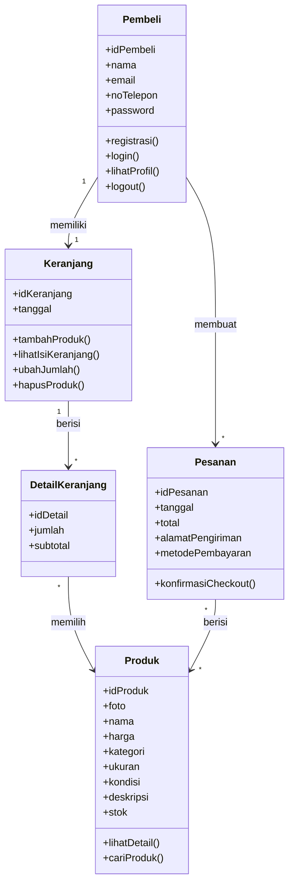

# CLASS DIAGRAM
## ClosetGirls ThriftShop

## 1. Tujuan

Class Diagram digunakan untuk menggambarkan struktur data dalam sistem ClosetGirls ThriftShop, meliputi class, atribut, method, serta hubungan antar-class.

## 2. Class yang Digunakan

Class yang digunakan dalam sistem ClosetGirls ThriftShop terdiri dari:

1. **Pembeli** — menyimpan data akun dan aktivitas pengguna.
2. **Produk** — menyimpan informasi produk thrift.
3. **Keranjang** — menyimpan keranjang milik Pembeli.
4. **DetailKeranjang** — menyimpan detail produk yang terdapat dalam keranjang.
5. **Pesanan** — menyimpan data pesanan setelah proses checkout.

## 3. Class Diagram

## 4. Penjelasan Class

### Pembeli
Class Pembeli menyimpan informasi akun pengguna yang melakukan aktivitas pada website ClosetGirls ThriftShop, seperti registrasi, login, melihat profil, dan keluar akun.

### Produk
Class Produk menyimpan informasi produk thrift yang ditampilkan kepada Pembeli, yaitu foto, nama, harga, kategori, ukuran, kondisi, deskripsi, dan stok.

### Keranjang
Class Keranjang digunakan untuk menyimpan produk yang dipilih oleh Pembeli sebelum melakukan checkout.

### DetailKeranjang
Class DetailKeranjang menyimpan rincian produk yang terdapat dalam keranjang, termasuk jumlah dan subtotal.

### Pesanan
Class Pesanan menyimpan data pesanan yang dibuat Pembeli melalui proses checkout, seperti tanggal, total, alamat pengiriman, dan metode pembayaran.

## 5. Relasi Antar-Class

| Relasi | Keterangan |
|---|---|
| Pembeli → Keranjang | Satu Pembeli memiliki satu Keranjang |
| Keranjang → DetailKeranjang | Satu Keranjang dapat memiliki banyak DetailKeranjang |
| DetailKeranjang → Produk | Setiap DetailKeranjang mengacu pada satu Produk |
| Pembeli → Pesanan | Satu Pembeli dapat membuat banyak Pesanan |
| Pesanan → Produk | Pesanan dapat berisi beberapa Produk |

## 6. Kesimpulan

Class Diagram ClosetGirls ThriftShop menggambarkan struktur data utama yang mendukung proses registrasi, login, pencarian dan detail produk, pengelolaan keranjang, checkout, serta pengelolaan profil Pembeli.
