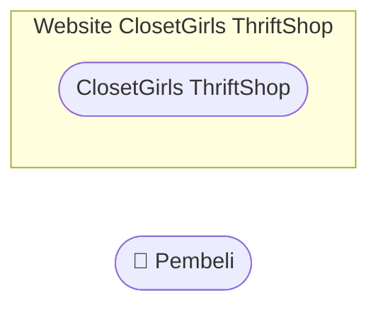

# Context Diagram
## ClosetGirls ThriftShop

## 1. Tujuan

Context Diagram dibuat untuk menggambarkan batas sistem ClosetGirls ThriftShop serta hubungan antara sistem dengan pihak yang berinteraksi langsung dengannya.

## 2. Pembeli

Pembeli merupakan satu-satunya pihak eksternal yang berinteraksi langsung dengan sistem. Pembeli menggunakan website ClosetGirls ThriftShop untuk melakukan registrasi, login, melihat beranda, mencari produk, melihat katalog dan detail produk, mengelola keranjang, melakukan checkout, melihat profil, serta keluar dari akun.

## 3. Sistem ClosetGirls ThriftShop

Sistem ClosetGirls ThriftShop menjadi pusat pengolahan data dan informasi yang digunakan oleh Pembeli. Seluruh proses interaksi Pembeli dengan fitur-fitur website dilakukan melalui sistem ClosetGirls ThriftShop.

## 4. Aliran Data

### Data dari Pembeli ke Sistem

- Data registrasi
- Data login
- Kata kunci pencarian produk
- Pilihan produk
- Data keranjang
- Konfirmasi checkout
- Akses profil
- Perintah keluar akun

### Data dari Sistem ke Pembeli

- Informasi akun
- Informasi beranda
- Hasil pencarian produk
- Katalog produk
- Detail produk
- Informasi keranjang
- Hasil checkout
- Informasi profil
- Konfirmasi keluar akun

## 5. Context Diagram

    Pembeli -->|"Data registrasi, login, pencarian produk, pilihan produk, data keranjang, konfirmasi checkout, akses profil, perintah keluar akun"| CS

    CS -->|"Informasi akun, beranda, hasil pencarian, katalog produk, detail produk, informasi keranjang, hasil checkout, informasi profil, konfirmasi keluar akun"| Pembeli
