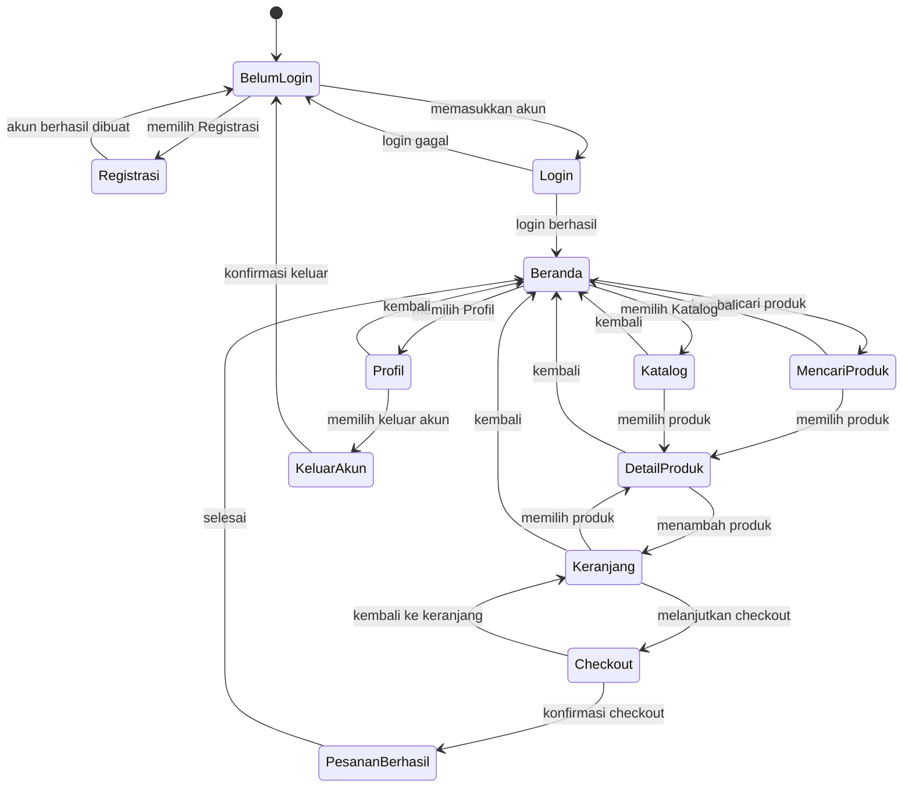

# STATE DIAGRAM
## ClosetGirls ThriftShop

## 1. Tujuan

State Diagram digunakan untuk menggambarkan perubahan keadaan yang terjadi pada sistem berdasarkan aktivitas atau kejadian yang dilakukan Pembeli.

## 2. State yang Digunakan

State utama pada sistem ClosetGirls ThriftShop adalah:

1. Belum Login
2. Login
3. Beranda
4. Mencari Produk
5. Melihat Katalog
6. Melihat Detail Produk
7. Mengelola Keranjang
8. Checkout
9. Pesanan Berhasil
10. Profil
11. Keluar Akun

## 3. State Diagram

## 4. Penjelasan State

### Belum Login
Pembeli belum masuk ke dalam sistem dan dapat melakukan registrasi atau login.

### Registrasi
Pembeli membuat akun baru. Setelah registrasi berhasil, Pembeli kembali ke halaman Login.

### Login
Pembeli memasukkan email dan kata sandi. Jika berhasil, sistem mengarahkan Pembeli ke Beranda.

### Beranda
Pembeli dapat melihat kategori dan produk serta menuju fitur lainnya.

### Mencari Produk
Pembeli memasukkan kata kunci untuk mencari produk yang diinginkan.

### Katalog
Pembeli melihat daftar produk berdasarkan kategori.

### Detail Produk
Pembeli melihat informasi lengkap produk seperti foto, nama, harga, kategori, ukuran, kondisi, deskripsi, dan stok.

### Keranjang
Pembeli melihat produk yang dipilih, mengubah jumlah, menghapus produk, atau melanjutkan ke Checkout.

### Checkout
Pembeli meninjau pesanan dan melakukan konfirmasi checkout.

### Pesanan Berhasil
Sistem menampilkan hasil checkout setelah pesanan berhasil dikonfirmasi.

### Profil
Pembeli melihat informasi akun.

### Keluar Akun
Pembeli melakukan konfirmasi untuk keluar dari sistem dan kembali ke halaman Login.

## 5. Kesimpulan

State Diagram ClosetGirls ThriftShop menggambarkan perubahan keadaan Pembeli mulai dari belum login, melakukan registrasi atau login, menggunakan fitur produk dan keranjang, melakukan checkout, melihat profil, hingga keluar dari akun. Diagram ini menunjukkan bagaimana sistem berpindah dari satu keadaan ke keadaan lainnya berdasarkan aktivitas yang dilakukan Pembeli.
